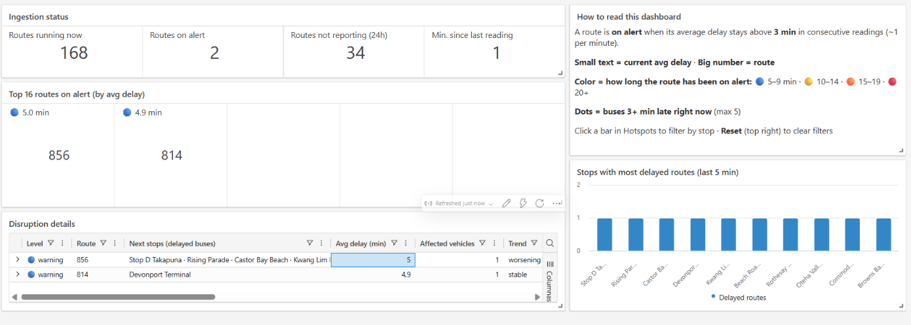
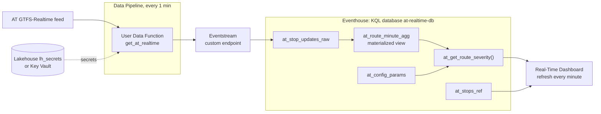
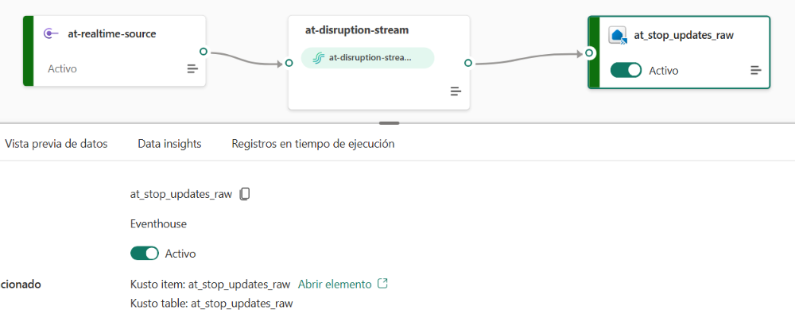
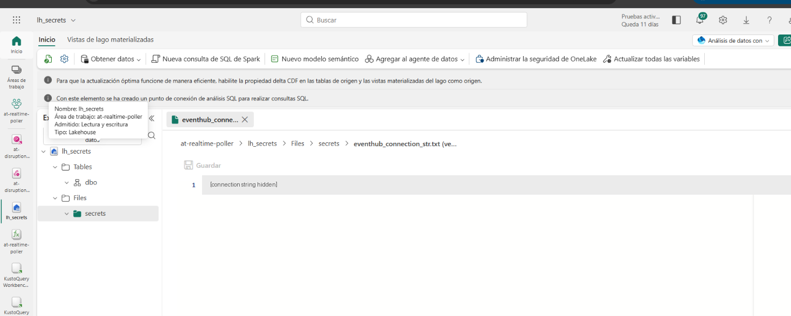
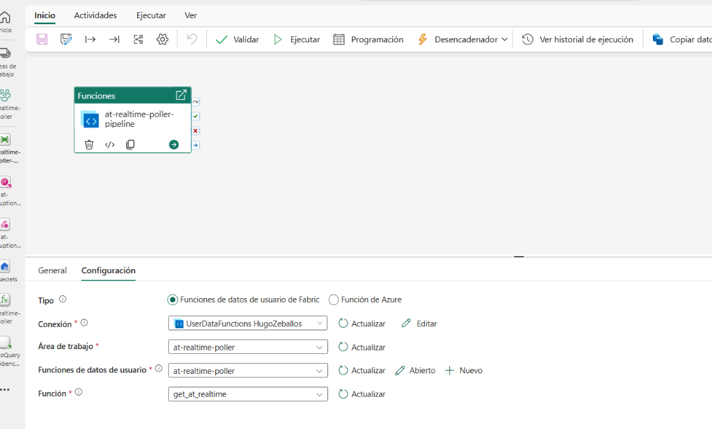
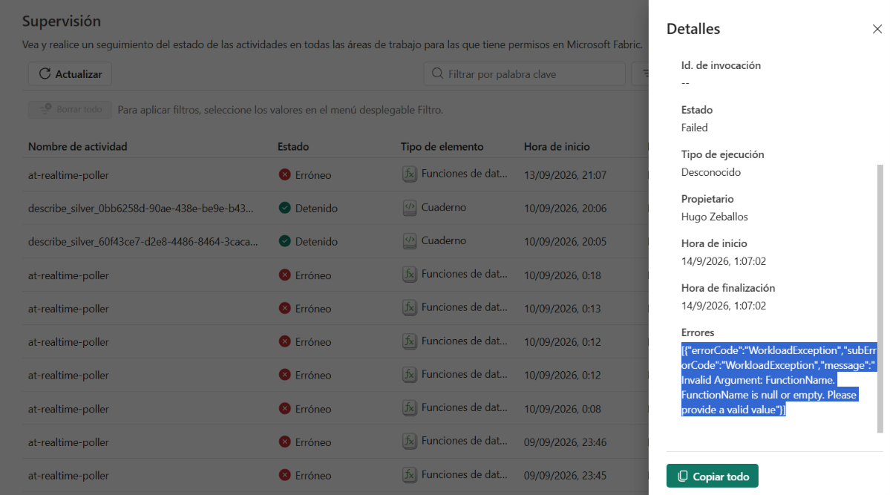

# Auckland bus disruptions in Fabric

A real-time disruption detector for Auckland buses, built on Microsoft Fabric Real-Time Intelligence as hands-on practice for the DP-700 exam. It polls Auckland Transport's GTFS-Realtime feed every minute and shows which routes are running late, for how long, and near which stops.



## Why this problem

In Auckland Transport's own surveys, most user comments were about cancelled or delayed services ([The Spinoff, 2023](https://thespinoff.co.nz/politics/26-04-2023/revealed-auckland-public-transport-user-satisfaction-hits-all-time-low)). In May 2025 the Auditor-General found that AT communicates planned disruptions well but struggles with unplanned ones, partly because its processes are largely manual, and that bus punctuality is measured only at the first and last stop of each route ([Office of the Auditor-General, 2025](https://ao.parliament.nz/2025/auckland-transport)).

This detector watches every stop, not just the ends of each route, and flags a route only when its delay persists for several minutes.

## Architecture



1. A **Data Pipeline** calls a **User Data Function** every minute.
2. The UDF reads two secrets, polls the AT feed, keeps only trip updates, flattens them and sends one event per stop update to an **Eventstream**.
3. The Eventstream writes them into a **KQL table**.
4. A **materialized view** aggregates each route per minute; a **function** turns those minutes into alert levels, a severity score and a trend.
5. A **Real-Time Dashboard** calls the function on every refresh.

## Repository contents

| Path | What it is |
| --- | --- |
| [`udf/get_at_realtime.py`](udf/get_at_realtime.py) | The User Data Function (secrets from a private Lakehouse) |
| [`udf/get_at_realtime_keyvault.py`](udf/get_at_realtime_keyvault.py) | The same entry point reading secrets from Azure Key Vault |
| [`kql/01_tables.kql`](kql/01_tables.kql) | Raw table and config table |
| [`kql/02_config_params.kql`](kql/02_config_params.kql) | Every threshold and weight |
| [`kql/03_materialized_view.kql`](kql/03_materialized_view.kql) | Per-minute aggregate without frozen trips |
| [`kql/04_functions.kql`](kql/04_functions.kql) | `at_recent_live_updates()` and `at_get_route_severity()` |
| [`kql/05_dashboard_queries.kql`](kql/05_dashboard_queries.kql) | The query behind every tile and parameter |
| [`dashboard/at-disruption-dashboard.json`](dashboard/at-disruption-dashboard.json) | Dashboard export, ready to import (data source IDs replaced by placeholders) |
| [`docs/`](docs/) | Spec and task documents from the Spec-Driven Development process |

## How to reproduce it

You need a Fabric capacity (the 60-day trial is enough) and a free API key from the [AT developer portal](https://dev-portal.at.govt.nz/). Build in this order, so every piece has its destination ready:

1. **Eventhouse** `at-realtime-db` → run [`kql/01_tables.kql`](kql/01_tables.kql).
2. **Eventstream** `at-disruption-stream` with a **Custom endpoint** source and the Eventhouse table as destination (JSON). Copy the source's connection string from *SAS Key Authentication*.

   

3. **Secrets.** Either an Azure Key Vault (recommended) or, without an Azure subscription, a Lakehouse `lh_secrets` in a private workspace with `Files/secrets/at_subscription_key.txt` and `Files/secrets/eventhub_connection_str.txt`.

   

4. **User Data Function** `at-realtime-poller`: add `azure-eventhub` in *Library management*, add the Lakehouse connection with alias `lhsecrets` in *Manage connections*, paste [`udf/get_at_realtime.py`](udf/get_at_realtime.py), set `EVENTHUB_NAME`, publish and run it once.
5. **Data Pipeline** with a *Functions* activity calling `get_at_realtime`, scheduled every minute. Set a distant end date on the schedule.

   

6. Run [`kql/02_config_params.kql`](kql/02_config_params.kql), [`kql/03_materialized_view.kql`](kql/03_materialized_view.kql) and [`kql/04_functions.kql`](kql/04_functions.kql).
7. Load `stops.txt` from AT's GTFS static zip into a table `at_stops_ref` (*Get data* → *Local file*, format CSV with header).
8. **Real-Time Dashboard**: import [`dashboard/at-disruption-dashboard.json`](dashboard/at-disruption-dashboard.json), then point its data source at your database. Auto refresh: 1 minute.

Check that data is arriving:

```kusto
at_stop_updates_raw
| summarize last_ingestion = max(ingestion_timestamp),
            rows_last_5_min = countif(ingestion_timestamp > ago(5m))
```

## How the alerts work

For every route, `at_get_route_severity()` answers three questions:

- **For how long?** The number of consecutive minutes, counting back from now, with an average delay of 3 min or more. 5 min = warning, 10 = yellow, 15 = orange, 20 = red.
- **How bad?** `severity = 0.5 × min(avg delay / 600 s, 1) + 0.3 × min(late buses / 8, 1) + 0.2 × trend bonus`
- **Getting worse?** The trend adds to severity only when the delay grew by more than 60 s.

Every threshold lives in `at_config_params`, so it can change without touching code. `signals_breakdown` shows which signal drove each score.

## What the data taught me

- **48% of trips were frozen.** AT keeps repeating the last known state of trips it has not updated, sometimes for over an hour. Their delays never change and distort the averages, so trips not updated in the last 5 minutes are dropped.
- **The feed's timestamp is not a clock.** It only changes when the trip changes. Time windows use the ingestion timestamp instead.
- **Buses run early too.** Negative delays produced negative severity scores until the average was clamped at zero.
- **Failures were silent.** A pipeline schedule that reached its end date, an expired Azure trial that disabled the Key Vault, and a rejected key that "succeeded" with 0 events all stopped the data without a visible error. The dashboard's *Min. since last reading* indicator exists because of them.
- **The UDF's own scheduler failed** every run with *FunctionName is null or empty*; a Data Pipeline runs the function reliably.



## Known limitations

- The feed also includes trains, ferries and special services; filtering on `route_type == 3` from GTFS `routes.txt` would keep only buses.
- Streaks are counted over the last 30 minutes, so longer ones show as "30+".
- `trend_diff_threshold_seconds` is used as a number of minutes and should be renamed.
- "Running now" means "reporting data now", not "in service according to the timetable".
- A few thresholds are repeated by hand in the materialized view and the dashboard legend.
- Secrets in a Lakehouse are acceptable for practice only; use Key Vault in production.
- The thresholds still need validation against AT's own service alerts during a weekday peak.

## DP-700 skills covered

Eventstream processing, KQL transformation (materialized views, functions, windowing with `serialize` and `row_cumsum`), pipeline orchestration and schedules, monitoring data ingestion, and workspace-level access control.

## Sources

- [The Spinoff: Auckland public transport user satisfaction hits all-time low](https://thespinoff.co.nz/politics/26-04-2023/revealed-auckland-public-transport-user-satisfaction-hits-all-time-low) (April 2023)
- [Office of the Auditor-General: Reliability of public transport in Auckland](https://ao.parliament.nz/2025/auckland-transport) (May 2025)
- [AT developer portal](https://dev-portal.at.govt.nz/): [Realtime API](https://dev-portal.at.govt.nz/realtime-api), [GTFS API](https://dev-portal.at.govt.nz/GTFS-API)
- [Exam DP-700 study guide](https://learn.microsoft.com/en-us/credentials/certifications/resources/study-guides/dp-700)

## Author

Hugo Zeballos, Auckland. Data analysis and visualisation.
